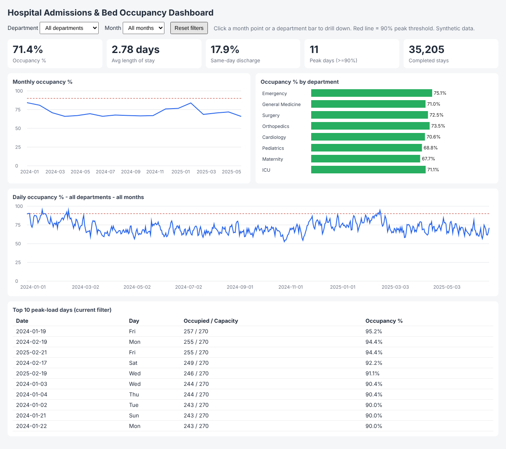

# Hospital Admissions & Bed Occupancy Dashboard
End-to-end analytics project: **Python** (cleaning, date handling) -> **Oracle SQL** (star schema, LOS & occupancy queries, views) -> **Power BI** (occupancy KPIs, slicers, drill-down).



**Live dashboard:** open `dashboard/index.html` in any browser (no install, works offline). Filters: department + month slicers, click-to-drill on month/department, daily view, peak-day table. After pushing, enable *Settings > Pages > main / root* and it is also viewable at `https://<username>.github.io/<repo>/dashboard/`.

## Headline results (synthetic data, 2024-01-01 to 2025-06-30)
See `docs/insights_summary.md`. Average LOS and occupancy % are computed under the rules in `docs/problem_statement_kpis.md`; peak-load days are listed there too.

## Project structure
```
data/raw/            admissions_raw.csv (dirty), department_beds.csv
data/processed/      fact_admission.csv, dim_*.csv, daily_occupancy.csv, los_verification_20.csv
python/              generate_data.py, clean_data.py (cell-marked '# %%' for Jupyter)
sql/                 01_ddl, 02b_dim_date, loader/*.ctl (SQL*Loader), 03_queries, 04_views, 05_verify_los
dashboard/           index.html (interactive dashboard), template.html
powerbi/             dax_measures.dax (optional Power BI version of the same KPIs)
docs/                problem statement & KPIs, ER diagram, DQ report, insights, Power BI guide, demo script
```

## How to run
```bash
pip install -r requirements.txt
python python/generate_data.py      # or drop in your own admissions extract (same columns)
python python/clean_data.py         # cleans, computes KPIs, writes reports
python python/build_dashboard.py    # rebuilds dashboard/index.html
```
Oracle: run `sql/01_ddl.sql`, then `cd sql/loader && ./run_load.sh user/pass@//host:1521/service`, then `sql/02b_dim_date.sql`, `sql/04_views.sql`, `sql/03_queries.sql`, `sql/05_verify_los.sql`.
Power BI (optional): follow `docs/powerbi_dashboard_guide.md`; the HTML dashboard already covers the same KPIs, slicers and drill-down.

## Edge cases handled
Same-day discharge, missing discharge date, overlapping stays (plus duplicates, discharge-before-admit, mixed date formats, department typos) - rules in `docs/problem_statement_kpis.md`, counts in `docs/data_quality_report.md`.

## Validation
* 20-patient LOS check (`data/processed/los_verification_20.csv`): pipeline LOS = Python date subtraction = day-by-day calendar count, all 20 match (asserted); SQL check in `sql/05_verify_los.sql`.
* Cross-check number: 19 Jan 2024 hospital occupancy = 257/270 beds (95.2%) in the CSV, the HTML dashboard and SQL Q9.

## Publish to GitHub (easy way)
Run `push_to_github.bat` (Windows) or `./push_to_github.sh` (Mac/Linux). Manual way:
```bash
git init && git add . && git commit -m "Hospital bed occupancy dashboard"
git branch -M main && git remote add origin https://github.com/<you>/hospital-bed-occupancy-dashboard.git && git push -u origin main
```
