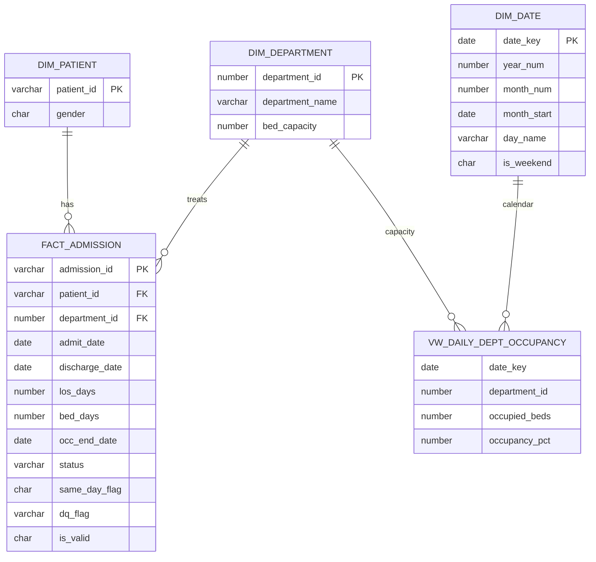

# Star Schema (ER Diagram)

**Why a daily view?** Occupancy is a per-day measure, but admissions are per-stay. The view expands each stay across the dates it
occupies a bed (`date BETWEEN admit_date AND occ_end_date`) so occupancy can be sliced by department, month, and day.
